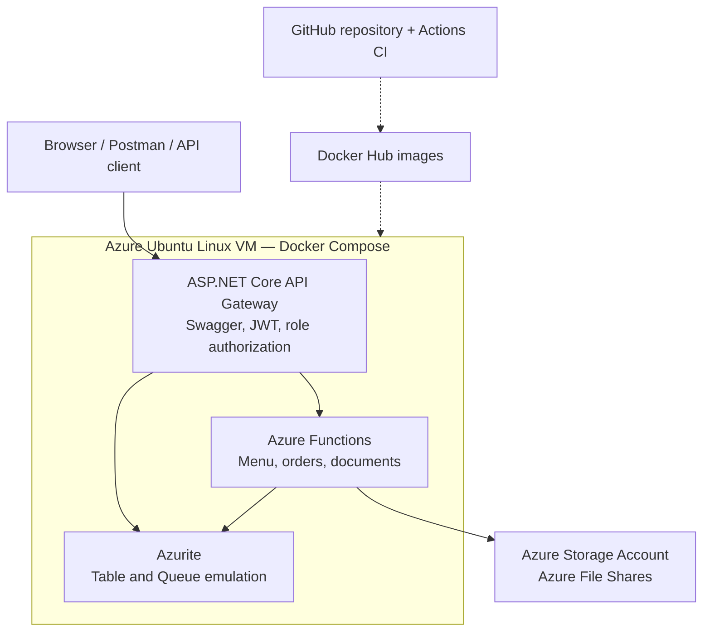

# CoffeeNChill — Parts 1, 2 and 3

## Part 3 — Secure API Gateway and Azure VPS deployment

**Submission:** Part 3 is merged into `main` (PR [#1](https://github.com/st10440548/CoffeeNChill/pull/1)). This README starts with the Part 3 submission evidence; previous Parts 1 and 2 instructions remain below.

### Submission links

| Resource | Link |
| --- | --- |
| GitHub source and commit history | [CoffeeNChill repository](https://github.com/st10440548/CoffeeNChill) |
| Part 3 video presentation | [Unlisted YouTube demonstration](https://youtu.be/sKwMP8QjEaw) |
| Live Azure VM Swagger UI | [http://172.209.216.237:5000/swagger](http://172.209.216.237:5000/swagger) |
| Live health endpoint | [http://172.209.216.237:5000/health](http://172.209.216.237:5000/health) |
| Live public menu endpoint | [http://172.209.216.237:5000/api/menu](http://172.209.216.237:5000/api/menu) |
| Deployment instructions | [Part 3 deployment guide](docs/PART3-DEPLOYMENT.md) |
| Test evidence | [Part 3 verification report](docs/PART3-LOCAL-TEST-RESULTS.md) |
| Postman collection | [Part 3 Postman JSON](docs/CoffeeNChill-Part3.postman_collection.json) |

The public health and menu endpoints returned HTTP 200 during verification on **2026-11-10**. Availability may change if the VM is stopped. The public endpoint is **HTTP only**; do not submit passwords or JWTs over the public connection.

### System architecture



The Gateway is exposed on VM port `5000`; the Functions HTTP port is internal to the Docker network. The Gateway handles JWT authentication and role-based access control for **Admin**, **Staff**, and **Customer** users. User profiles are persisted in Azure Table-compatible storage, and passwords are hashed. Public registration creates Customer accounts; Administrators provision Staff accounts. Orders are queued and progress through Received → Preparing → Ready → Collected. Azure Files uses a real Azure Storage account because Azurite does not emulate File Shares.

### Project structure

| Path | Purpose |
| --- | --- |
| `Gateway/` | ASP.NET Core API Gateway, authentication, Swagger and controllers |
| `Functions/` | Azure Functions business logic and storage integrations |
| `docker-compose.yml` | Container orchestration |
| `docs/` | Postman collection, deployment instructions and verification evidence |
| `scripts/` | Smoke and integration tests |
| `.github/workflows/` | CI and image-publishing workflow definitions |

### Running and verifying Part 3

1. Read [the deployment guide](docs/PART3-DEPLOYMENT.md) for Docker images, environment variables and Azure VM configuration. Copy the example environment file and provide your own secrets; **never commit `.env` or credentials**.
2. With the deployment configured, run `docker compose pull && docker compose up -d`, then `docker compose ps`.
3. Open `http://localhost:5000/swagger` on the host (or the public Swagger URL above for non-sensitive GET requests).
4. Run the integration checks on the VM, using localhost:

```bash
BASE_URL=http://localhost:5000 bash scripts/part3-smoke.sh
BASE_URL=http://localhost:5000 python3 scripts/part3-admin-staff-test.py
BASE_URL=http://localhost:5000 python3 scripts/part3-menu-crud-test.py
BASE_URL=http://localhost:5000 python3 scripts/part3-order-queue-test.py
BASE_URL=http://localhost:5000 python3 scripts/part3-staff-permissions-test.py
```

**Verification evidence (2026-11-10):** all five integration test suites passed against the Azure VM. Verified flows include Administrator/Staff login, Customer restrictions (401/403), menu CRUD, order processing, and Azure Files upload (201), list (200), download/content check (200), and delete (204). See the [test report](docs/PART3-LOCAL-TEST-RESULTS.md) for details.

**Postman:** the Part 3 collection is provided for API testing, but a complete Part 3 Postman Runner execution is **not claimed** as verified or demonstrated in the submitted video. The Python integration suites are separate evidence.

**CI/CD scope:** GitHub Actions workflow definitions exist for validation and image publishing. Images were published and deployed using Docker Hub and Compose; an automated SSH deployment from GitHub Actions is not claimed.

**Security note:** the coursework VM's public port 5000 is plain HTTP. For JWT or password-based testing, use an SSH tunnel to `127.0.0.1:5000` on the VM or configure HTTPS first.

---


## Previous Parts 1 and 2 instructions


The application was successfully built and run on an Apple M1 Mac using Docker Desktop. The Functions image uses linux/amd64 emulation. Docker Compose started both services, and Azurite reported healthy.

All 11 core Postman requests were tested individually and passed. Tests covered menu creation, listing, category filtering, updating, deletion, invalid inputs, order queuing, order status and missing orders. The test order reached Collected, with timestamps persisted for Received, Preparing, Ready and Collected.

Azure Files document endpoints were subsequently verified on the Part 3 Azure VM on 2026-11-10 (upload 201, list 200, download/content check 200, delete 204).

1. Copy `.env.example` to `.env` and replace `yourdockerhubusername` with your actual username.
2. Make your two Docker Hub repositories public: `coffeenchill-functions` and `coffeenchill-azurite`.
3. Build and publish the images with either:

```powershell
./scripts/publish.ps1 -DockerHubUsername YOUR_USERNAME
```

```bash
export DOCKERHUB_USERNAME=YOUR_USERNAME
bash scripts/publish.sh
```

4. Start the published images:

```bash
docker compose pull
docker compose up -d
docker compose logs -f functions
```

Compose contains `image:` references to your Docker Hub images and no `build:` entries, meeting the Part 2 marking rule. It uses a Docker network endpoint for Azurite; `UseDevelopmentStorage=true` would point at the Functions container itself and would fail here.

5. Import `docs/CoffeeNChill.postman_collection.json`. Select **Core - menu and asynchronous orders**, run its requests in order using Collection Runner, with **1000 ms delay**. The collection creates unique IDs, tests menu CRUD and queues an order, then polls until Collected. Check runner results: all final assertions must pass. Use functions logs and Azure Storage Explorer to show intermediate states and the Orders table. Polling can return 404 briefly before the queue worker creates the order.
6. Add actual team names/contributions and your unlisted YouTube demo link below. Push all source to GitHub and submit the repository URL.

## Azure Files limitation in the assignment

Azurite supports Blob, Queue and Table services, **not Azure File Shares**. The brief also swaps some port labels; actual ports are Blob 10000, Queue 10001, Table 10002. This implementation uses those real ports.

The staff document functions use the real Azure Files SDK and `staff-docs` share. Set `AZURE_FILES_CONNECTION_STRING` in `.env` to a real Azure Storage account connection string to use them, then recreate the Functions container with `docker compose up -d --force-recreate functions`. Without this setting, the document endpoints return a clear HTTP 503 instead of pretending a Blob container is a File Share. Part 2 menu/order functionality works entirely locally without Azure Files. Ask your lecturer how they want the incompatible Part 1 emulator/file-share requirement handled if a real storage account is unavailable.

For document tests, select `docs/sample-staff-document.txt` in the upload request's file field, configure Postman's working directory if necessary, and run the Documents folder. Never commit real credentials, `.env`, or real-storage local.settings.json.

## Part 1 standalone Docker execution (no Compose)

Build a Part 1-labelled image if Part 1 evidence is also required:

```bash
docker build -t YOUR_USERNAME/coffeenchill-functions:v1.0 .
docker push YOUR_USERNAME/coffeenchill-functions:v1.0
docker network create coffeenchill-net
docker run -d --name azurite --network coffeenchill-net -p 127.0.0.1:10000:10000 -p 127.0.0.1:10001:10001 -p 127.0.0.1:10002:10002 YOUR_USERNAME/coffeenchill-azurite:v1.0 azurite --blobHost 0.0.0.0 --queueHost 0.0.0.0 --tableHost 0.0.0.0 --skipApiVersionCheck
```

Copy `.env.standalone.example` to `.env.standalone`. Set `AzureFilesConnectionString` there if testing documents; keep this file out of Git. Run:

```bash
docker run -d --name coffeenchill-functions --network coffeenchill-net -p 127.0.0.1:7071:80 --env-file .env.standalone YOUR_USERNAME/coffeenchill-functions:v1.0
```

The v1.0 command packages the same combined source; it does not manufacture a historical Part 1 implementation. Stop/remove the standalone containers before starting Compose, since they bind the same ports.

## Local development

Start Azurite separately; copy `local.settings.json.example` to `local.settings.json` (the supplied local settings also work). Run `dotnet build` and `func start`. `UseDevelopmentStorage=true` is appropriate when both host processes run on your computer. Do not combine that shortcut with separate containers.

## Endpoints

| Method | Route | Purpose |
|---|---|---|
| POST | /api/menu | Add menu item |
| GET | /api/menu | List menu |
| GET | /api/menu/category/{category} | Filter category |
| PUT | /api/menu/{category}/{id} | Update price / availability |
| DELETE | /api/menu/{category}/{id} | Delete menu item |
| POST | /api/documents/upload | Multipart file field to Azure Files |
| GET | /api/documents | File names, sizes, modification dates |
| GET | /api/documents/download/{fileName} | Download file |
| POST | /api/orders/queue | Enqueue order, return 202 |
| GET | /api/orders/{orderDate}/{orderId} | Inspect persisted status |

Sample order matches the supplied specification. The collection supplies a current ISO-8601 timestamp automatically:

```json
{"OrderId":"ORD-2026-8801","CustomerName":"Jane Smith","SelectedItemSKUs":["COF-001","PAS-104"],"TotalPrice":65.0,"OrderTimestamp":"2026-10-12T10:15:00Z"}
```

Menu JSON uses `Category`, `Id`, `Name`, `Description`, `Price`, `IsAvailable`. Category/Id map to Table PartitionKey/RowKey. SelectedItemSKUs are stored as JSON text because Table Storage cannot store string arrays directly. Prices use Double, as allowed by the brief. This simulation accepts supplied order totals and SKUs; it does not recalculate totals or check inventory.

## Reliability and simulation boundaries

Queue producer and trigger agree on Base64 encoding. The trigger resumes an existing matching order from its stored state on retry, and uses ETags to avoid overwriting concurrent changes. Duplicate messages can be delivered; this is at-least-once processing, not exactly-once delivery. Reusing an ID/date with different order details is rejected by the worker and eventually routed to `order-processing-queue-poison` after five failed attempts. Check logs and the poison queue if an order stalls.

Each transition waits three seconds by default. The automatic Collected transition is explicitly a simulation required by the brief; it is not confirmation of a real customer collection. Status timestamps let tests prove all stages occurred even if a GET misses a short-lived intermediate stage. HTTP functions are anonymous and ports are bound to localhost for this local coursework demonstration. JWT/API gateway/VPS work belongs to Part 3.

## Part 2 changelog

- Added POST order producer and Base64 JSON queue messages.
- Added ProcessOrderQueue background trigger with status transitions and retry handling.
- Added Orders table and GET status endpoint for demonstrations and tests.
- Added Docker Compose pulling published v2.0 Functions and v1.0 Azurite images.
- Updated Postman collection, setup guide and demo checklist.

## Team contributions 
Ronald - st10440548
Docker setup and publishing, Postman testing, troubleshooting, and documentation updates

## Project links

- GitHub: https://github.com/st10440548/CoffeeNChill
- Functions image: https://hub.docker.com/r/primetimeron/coffeenchill-functions
- Azurite image: https://hub.docker.com/r/primetimeron/coffeenchill-azurite


Unlisted YouTube URL: **https://youtu.be/jV6GQF-TlWQ**

## References

- https://learn.microsoft.com/en-us/azure/azure-functions/dotnet-isolated-process-guide
- https://learn.microsoft.com/en-us/azure/storage/common/storage-use-azurite
- https://learn.microsoft.com/en-us/azure/storage/common/storage-connect-azurite
